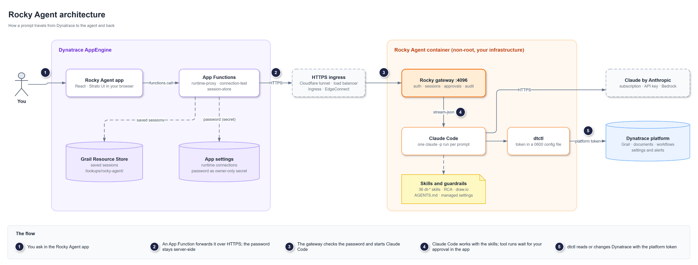

# Rocky Agent

**An AI agent for Dynatrace that you run yourself.** From a Dynatrace app you
ask for a root cause analysis, a log or alert review, a dashboard or a
workflow; the agent ([Claude Code](https://code.claude.com)) investigates with
`dtctl` and the official Dynatrace skills. It works read-only by default and
asks before it changes anything.

> [!IMPORTANT]
> **Disclaimer.** Rocky Agent is a community app. It is not an official
> Dynatrace product, it is not affiliated with Anthropic, and Dynatrace doesn't
> support it. The only support is the one the author offers through this
> repository ([open an issue](https://github.com/Edunzz/dynatrace_apps_rocky_agent/issues)).
> Use it at your own risk.

## Getting started

In about 15 minutes you will:

1. create two Dynatrace tokens,
2. install the **app** in Dynatrace (from GitHub Codespaces, nothing to install),
3. run the **agent runtime** on your computer with Docker,
4. let Dynatrace reach it, and
5. connect the app to it.

**Before you start** you need:

* a Dynatrace SaaS environment where you can install apps and edit settings;
* a GitHub account;
* [Docker Desktop](https://www.docker.com/products/docker-desktop/);
* a Claude subscription (Pro, Max, Team or Enterprise) or an Anthropic API key.

### Step 1: Create two platform tokens

One token installs the app, the other one is what the agent uses to work in
Dynatrace.

1. Open [My platform tokens](https://myaccount.dynatrace.com/platformTokens) →
   **Platform token**.
2. Give it a name and an expiration date, choose your environment and add the
   scopes below.
3. Select **Generate** and copy the token right away (it is shown only once;
   it starts with `dt0s16.`).

**App token** (installs the app in step 2):

```text
app-engine:apps:install
app-engine:apps:run
app-engine:apps:delete
```

**Runtime token** (the agent uses it in step 3). It lets the agent read your
data and lookup tables, and create notebooks, workflows and alerts after you
confirm:

```text
storage:buckets:read
storage:logs:read
storage:metrics:read
storage:spans:read
storage:events:read
storage:entities:read
storage:smartscape:read
storage:bizevents:read
storage:user.events:read
storage:user.sessions:read
storage:system:read
storage:files:read
document:documents:read
document:documents:write
automation:workflows:read
automation:workflows:write
automation:workflows:run
settings:schemas:read
settings:objects:read
settings:objects:write
```

| Scopes | What the agent can do with them |
|---|---|
| `storage:*:read` | Query logs, metrics, traces, events, entities, business data and user sessions |
| `storage:files:read` | Read lookup tables (`load "/lookups/…"` in DQL) |
| `document:documents:*` | Read notebooks and dashboards, and create its own (for example the RCA notebook) |
| `automation:workflows:*` | Read, create and run workflows |
| `settings:*` | Read settings and create alerts (Davis anomaly detectors are settings objects) |

A token can never do more than the user it belongs to. Already have an app
token for another Edunzz Dynatrace app? Reuse it. For a team, create the
runtime token for a service user ([how](docs/dynatrace-setup.md)).

### Step 2: Install the app in Dynatrace

1. Click this button:

   [](https://codespaces.new/Edunzz/dynatrace_apps_rocky_agent)

2. On the creation page, fill in the two recommended secrets and select
   **Create codespace**:

   | Secret | Value |
   |---|---|
   | `DT_APP_ENVIRONMENT_URL` | `https://<environment-id>.apps.dynatrace.com` |
   | `DT_APP_PLATFORM_TOKEN` | the **app token** from step 1 |

3. When the terminal shows *Rocky Agent app — ready to deploy*, run the
   command below and press **Enter** twice to keep your values:

   ```bash
   npm run deploy:token
   ```

   It ends with the app link:
   `https://<environment-id>.apps.dynatrace.com/ui/apps/my.rocky.agent`.

You can stop the codespace now; the app stays installed.

### Step 3: Start the runtime on your computer

1. Download the project and create your settings file:

   ```bash
   git clone https://github.com/Edunzz/dynatrace_apps_rocky_agent.git
   cd dynatrace_apps_rocky_agent
   cp .env.example .env          # Windows (PowerShell): copy .env.example .env
   ```

2. Open `.env` in any editor and fill in three lines:

   | Line | Value |
   |---|---|
   | `DT_PLATFORM_URL` | `https://<environment-id>.apps.dynatrace.com` |
   | `DT_PLATFORM_TOKEN` | the **runtime token** from step 1 |
   | `ROCKY_SERVER_PASSWORD` | a password you choose, **16 characters or more**. If you leave it empty the public default `gundamjromero2026` is used: it works, but **change it** |

3. Start the runtime with a public HTTPS tunnel, so Dynatrace can reach it, and
   copy the tunnel address:

   ```bash
   docker compose --profile tunnel up -d    # the first time it downloads the image
   docker compose logs tunnel               # copy the https://….trycloudflare.com address
   ```

   If `up` says *container … is unhealthy*, run `docker compose logs rocky-agent`,
   fix the `[FAIL]` line (usually a password shorter than 16 characters) and
   run `up` again.

4. Sign in to Claude (once; the login is kept between restarts):

   ```bash
   docker compose run --rm rocky-agent login
   ```

   Open the address it prints, sign in with your Claude account, copy the code
   the page shows and paste it into the terminal once (it stays hidden while you
   paste) and press **Enter**. Using an Anthropic API key instead? Skip this
   and set `ANTHROPIC_API_KEY` in `.env`.

> [!NOTE]
> A Claude subscription is for **your own** use: don't let other people use
> the agent through your runtime. Teams use an Anthropic API key or a cloud
> provider ([details](agent-runtime/README.md#signing-in-to-claude)).

### Step 4: Let Dynatrace call the tunnel (once)

In Dynatrace open **Settings → General → External requests**, add the host
`*.trycloudflare.com` and select **Save**. This needs settings permission; ask
an admin if you cannot edit it.

### Step 5: Connect and rock

1. Open the app link from step 2.
2. Create a **runtime connection**:
   * **Runtime URL**: the `https://….trycloudflare.com` address from step 3;
   * **Username**: `rocky`;
   * **Password**: your `ROCKY_SERVER_PASSWORD` (or `gundamjromero2026` if you
     left it empty; the app then reminds you to change it).
3. Select **Test connection**: every step should pass, including *Claude
   sign-in*. Then select **Save connection**.
4. Pick a suggested prompt (or write your own) and select **Let’s Rock**.

**Day to day.** Stop with `docker compose --profile tunnel down` and start
again with the same `up` command. Your Claude login and sessions are kept, but
the tunnel address changes on every start: edit the connection in the app with
the new address.

> [!WARNING]
> The tunnel puts your runtime on the Internet at a random address, protected
> only by your password. Use it to try Rocky Agent; for teams use a
> [server or cloud deployment](#deploy-it-elsewhere) with your own HTTPS address.

---

# Documentation

* [How it works](#how-it-works)
* [Using the app](#using-the-app)
* [Security](#security)
* [Configuration](#configuration)
* [Platform token profiles](#platform-token-profiles)
* [Deploy it elsewhere](#deploy-it-elsewhere)
* [Troubleshooting](#troubleshooting)
* [Upgrades and development](#upgrades-and-development)
* [Known limitations](#known-limitations)

## How it works



<sub>Editable source: [docs/images/architecture.drawio](docs/images/architecture.drawio).</sub>

Two parts work together:

| Part | Where it runs | What it does |
|---|---|---|
| **Dynatrace app** ([`dynatrace-app/`](dynatrace-app/README.md)) | Dynatrace AppEngine | The chat, status lights, approvals and saved sessions. Its App Functions call the runtime server-side, so the runtime password never reaches the browser |
| **Agent runtime** ([`agent-runtime/`](agent-runtime/README.md)) | A container you run: your computer, a server or the cloud | The **Rocky gateway** (port 4096) checks the password, keeps sessions and starts one Claude Code run per prompt. Claude Code works with `dtctl` 0.45.0, the 36 official `dt-*` skills, the RCA skill and a draw.io skill. Image: [`edunzz/rocky-agent`](https://hub.docker.com/r/edunzz/rocky-agent) |

The platform token stays inside the container: it is written to dtctl's config
file (mode 0600) and removed from the environment before Claude Code starts.
Deployment templates live in [`deploy/`](deploy/) and detailed guides in
[`docs/`](docs/).

## Using the app

* **Status lights** at the top show the runtime, Claude Code, the Claude
  sign-in, Dynatrace, dtctl and the skills. The ⓘ button shows the version,
  the author and the disclaimer.
* **New session** opens the start page with the suggested prompts: RCA, log
  value and sensitive data, alert quality and business dashboards.
* **Approvals.** The agent reads freely, but any other command or file change
  waits for you in the app (**Approve once** or **Reject**). Before it changes
  anything in Dynatrace it describes the change (target, impact, rollback) and
  waits for you to reply `CONFIRM: Execute the described change`; a
  confirmation covers one operation.
* **Auto-approve** (in the session header) approves the agent's tool requests
  for that session without asking, while the page is open. Dynatrace changes
  still need your `CONFIRM`, and the token's scopes and `DTCTL_SAFETY_LEVEL`
  still apply. Turn it on only for agents and data you trust.
* **Sessions.** Runtime sessions live in the runtime and disappear if you
  remove its volumes. **Save to Dynatrace** stores the conversation as an
  immutable, redacted snapshot in Grail Resource Store
  (`/lookups/rocky-agent/`), which you can rename, download as Markdown or
  delete.
* **Policy.** Every run follows a protected baseline
  ([AGENTS.md](agent-runtime/AGENTS.md) plus root-owned Claude Code managed
  settings). Before a session starts you can add your own restrictions;
  statements that would weaken the baseline are rejected.

## Security

* **Never expose port 4096 directly to the Internet.** Put HTTPS (a load
  balancer, ingress or reverse proxy) in front of it and restrict who can reach
  it.
* **Change the default password.** `gundamjromero2026` is public. The runtime
  accepts it so a first run needs no setup, but anyone who finds the runtime's
  address could use your agent, your Dynatrace token and your Claude account.
  The startup log, the connection test and the app warn until you change it.
* **Use a dedicated service user** for the runtime token, with only the scopes
  you need. The token's scopes are the real limit of what the agent can do.
* **One Claude subscription, one person.** Anthropic does not allow sharing a
  subscription login through a runtime other people use.
* **Saved sessions** need this IAM policy for app users:

  ```text
  ALLOW storage:files:read, storage:files:write, storage:files:delete
    WHERE storage:file-path startsWith "/lookups/rocky-agent/";
  ```

More: [secrets](docs/security/secrets.md), [threat model](docs/security/threat-model.md),
[SECURITY.md](SECURITY.md).

## Configuration

The runtime reads these variables from `.env` (or your secret manager):

| Variable | Default | Purpose |
|---|---|---|
| `DT_PLATFORM_URL` | (required) | `https://<environment-id>.apps.dynatrace.com` |
| `DT_PLATFORM_TOKEN` | (required) | Runtime platform token (secret, never leaves the container) |
| `ROCKY_SERVER_PASSWORD` | `gundamjromero2026` (public) | Runtime password; one you choose needs 16+ characters |
| `ROCKY_SERVER_USERNAME` | `rocky` | Runtime username |
| `DTCTL_SAFETY_LEVEL` | `readwrite-mine` | `readonly`, `readwrite-mine` (only what the token's user owns) or `readwrite-all` |
| `ROCKY_MODEL` | Claude Code default | Model alias (`sonnet`, `opus`) or full name |
| `LOG_LEVEL` | `info` | `debug`, `info`, `warn`, `error` |

**Claude credential** (one of them):

| Option | How | Who may use the runtime |
|---|---|---|
| Subscription login | `docker compose run --rm rocky-agent login` | You only |
| Subscription token | `docker compose run --rm rocky-agent setup-token` → `CLAUDE_CODE_OAUTH_TOKEN` | You only |
| Anthropic API key | `ANTHROPIC_API_KEY` | Your team |
| Amazon Bedrock, Google Vertex AI, Microsoft Foundry | `CLAUDE_CODE_USE_BEDROCK=1` (or `_VERTEX`, `_FOUNDRY`) + provider settings | Your team |

`docker compose run --rm rocky-agent auth-status` shows which credential is in
use. All variables (ports, timeouts, origins, concurrency): [agent-runtime/README.md](agent-runtime/README.md#environment-variables).

## Platform token profiles

| Profile | `DTCTL_SAFETY_LEVEL` | What the agent can do |
|---|---|---|
| **Starter** (Getting started, 20 scopes) | `readwrite-mine` | Read data and lookup tables; create its own notebooks, workflows and alerts after you confirm |
| **Recommended** (53 scopes) | `readwrite-mine` | Everything dtctl supports on resources the token's user owns, including dashboards, SLOs and segments |
| **Read-only** (39 scopes) | `readonly` | Investigate only; it cannot publish anything, not even the RCA notebook |

The full lists, with copy buttons, are in the app under **Dynatrace platform
token** and in [docs/dynatrace-setup.md](docs/dynatrace-setup.md). Installing
the app without a browser sign-in (Codespaces, CI) uses the separate **app
token** from step 1.

## Deploy it elsewhere

| Where | Templates | Guide |
|---|---|---|
| Your computer + tunnel (Getting started) | [`docker-compose.yml`](docker-compose.yml) | [local.md](docs/deployment/local.md) |
| Your computer with `dt-app dev` (no tunnel) | [`docker-compose.yml`](docker-compose.yml) | [local.md, option B](docs/deployment/local.md#option-b-run-the-app-locally-with-dt-app-dev) |
| Docker on a server | [`docker-compose.yml`](docker-compose.yml), [`deploy/local/`](deploy/local/) | [docker.md](docs/deployment/docker.md) |
| Amazon ECS (Fargate) | [Terraform](deploy/aws-ecs/terraform/), [CloudFormation](deploy/aws-ecs/cloudformation/rocky-agent.yaml) | [aws-ecs.md](docs/deployment/aws-ecs.md) |
| Azure Container Apps | [Bicep](deploy/azure-container-apps/bicep/main.bicep), [Terraform](deploy/azure-container-apps/terraform/) | [azure-container-apps.md](docs/deployment/azure-container-apps.md) |
| Kubernetes | [Kustomize](deploy/kubernetes/) | [kubernetes.md](docs/deployment/kubernetes.md) |
| A runtime you already run | — | [existing-runtime.md](docs/deployment/existing-runtime.md) |

On a server or in the cloud: put HTTPS in front of the runtime, allow its host
under **Settings → General → External requests** (private networks go through
Dynatrace EdgeConnect) and connect the app to it. Start with 1 vCPU, 2 GiB of
memory and 20 GiB of disk, and run **one replica** (sessions live inside one
runtime). The app can also be installed without Codespaces:
`cd dynatrace-app && npm ci && npm run deploy` ([details](dynatrace-app/README.md)).

## Troubleshooting

| Symptom | Fix |
|---|---|
| `up` says *container … is unhealthy* | `docker compose logs rocky-agent`, fix the `[FAIL]` lines (usually a password shorter than 16 characters), run `up` again |
| **Claude: Not signed in** or **Sign-in rejected** | `docker compose run --rm rocky-agent login`, or set `CLAUDE_CODE_OAUTH_TOKEN` / `ANTHROPIC_API_KEY` |
| `login` times out or says `status code 400` | Run `login` again and paste the newest code once. Still failing? Run `claude setup-token` on a computer with Claude Code and put the token in `.env` as `CLAUDE_CODE_OAUTH_TOKEN` |
| **Dynatrace: unavailable** or **authentication failed** | Check the runtime can reach `*.apps.dynatrace.com`; recreate the token; check `DT_PLATFORM_URL` |
| App: *runtime could not be reached* | Allow the host in External requests; use a public certificate; private networks need EdgeConnect |
| App: *authentication failed* | Edit the connection: the username is `rocky`, re-enter the password |
| App: **Change the runtime password** | Set `ROCKY_SERVER_PASSWORD` in `.env` (16+ characters), run `up` again, edit the connection |
| `session_busy` (409) | The agent is still working: wait or **Stop generation** |
| Saved sessions list is empty | Grant `storage:files:read` and the IAM policy in [Security](#security) |

More: [docs/operations.md](docs/operations.md).

## Upgrades and development

**Upgrade:** read the [release notes](docs/release-notes.md), save any runtime
session you want to keep, deploy the new image tag and app version, and run
the connection test. Saved sessions are not affected.

**Build the image yourself:**
`docker compose -f docker-compose.yml -f docker-compose.build.yml --profile tunnel up -d --build`.

**Run the tests:**

```bash
cd agent-runtime && npm test                                                          # runtime (Node.js 24)
cd dynatrace-app && npm ci && npm run typecheck && npm run lint && npm test           # app
```

End-to-end checks with the real image and a mock Anthropic API, and how to bump
pinned versions: [CONTRIBUTING.md](CONTRIBUTING.md).

## Known limitations

* The agent and dtctl run as the same Unix user: permission rules and
  redaction protect the token, but the token's scopes are the real boundary.
* Auto-approve works only while the session page is open in your browser.
* App Functions cannot trust private CAs or skip TLS checks.
* IAM cannot restrict each user to their own saved-session folder.
* One replica per runtime; sessions are not shared between replicas.
* The ECS, Azure and Kubernetes templates are validated in CI but have not been
  applied to live cloud accounts by this project.

Full list: [docs/implementation-plan.md](docs/implementation-plan.md#5-known-limitations-open).

## License

[MIT](LICENSE). See the [disclaimer](#rocky-agent) above.
